

<a href="https://xynorash.github.io/xynorash/"></a>
<a href="https://daily.dev/xynorash"></a>




<a href="https://xynorash.github.io/xynorash/"></a>

<a href="https://github.com/Xynorash"></a><a href="mailto:nashtefison@gmail.com"></a><a href="https://www.linkedin.com/in/nash-tefison-5a343b315"></a>
<a href="https://app.daily.dev/xynorash"></a><a href="https://www.facebook.com/profile.php?id=100014438106807"></a>


